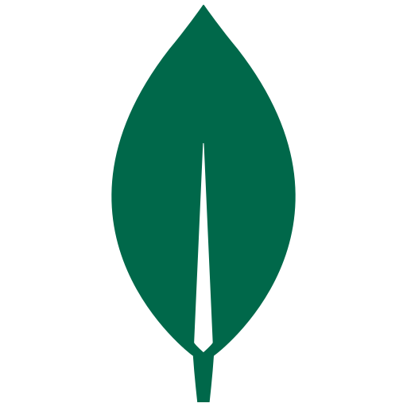
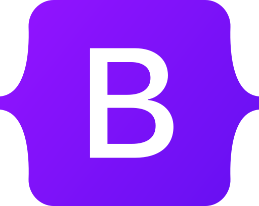
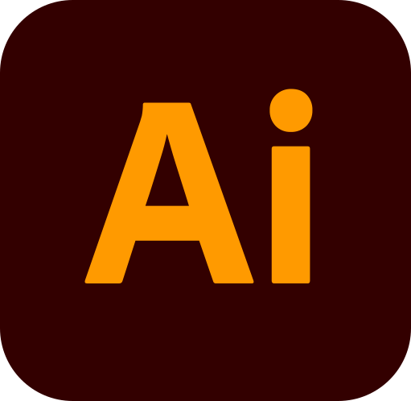

# 👋 Hi there, My name is Takuto!
I'm currently studying Web Development in Cornerstone Community College.
And, I'm looking for Web Development or Software engineer position now.
## 💾 PROFILE SUMMARY
- Digital design and web development professional with over 3 years of experience in project management, digital content creation, website maintenance, and visual communication across technology and community-focused projects.
- Availability: Full-time employment starting in November 2027.
```
name: Takuto Yokomaku
based_in: Vancouver, British Columbia
Position: Full Stack Developer
background: [
    "Graphic Designer",
    "Project Manager",
    "Engineer"
    ]
interests: [
  "Web and Mobile Development",
  "UI/UX Design",
  "Graphic Design"
  ]
currently_learning: [
  "JavaScript",
  "TypeScript"
  ]
primal_goals: [
    "Get a job at a Canadian or American Tech company",
    "Contribute start-up ecosystem in Canada"
  ]
hobbies: [
  "Gaming",
  "Reading Books",
  "Traveling",
  "Watching Movies"
  ]
```
## 🛠️ TECH STACK
### ● Fronted Languages
   

HTML, CSS, SCSS, JavaScript, TypeScript
### ● Backend Languages
  

Node.js, PostgreSQL, MongoDB
### ● Frameworks
   

React.js, Next.js, Tailwind CSS, Bootstrap
### ● Tools
         

GitHub, npm, WordPress, Adobe Illustrator, Adobe Photoshop,  Adobe Premiere, Figma, Docker, Firebase, Vercel
### ● Design Concepts
System Design, Data Structures & Algorithms, UI&UX, Microservices, Security, Visual Communication, Severless
### ● Project Management
Website Maintenance, Version Control, Cross-functional Collaboration, Project Coordination

## 💼 Work Experience
- Patent Searcher & Data Engineer | Toyota Motor Corporation | Japan
- Designer & Project Manager | Kachinode Inc. | Japan
