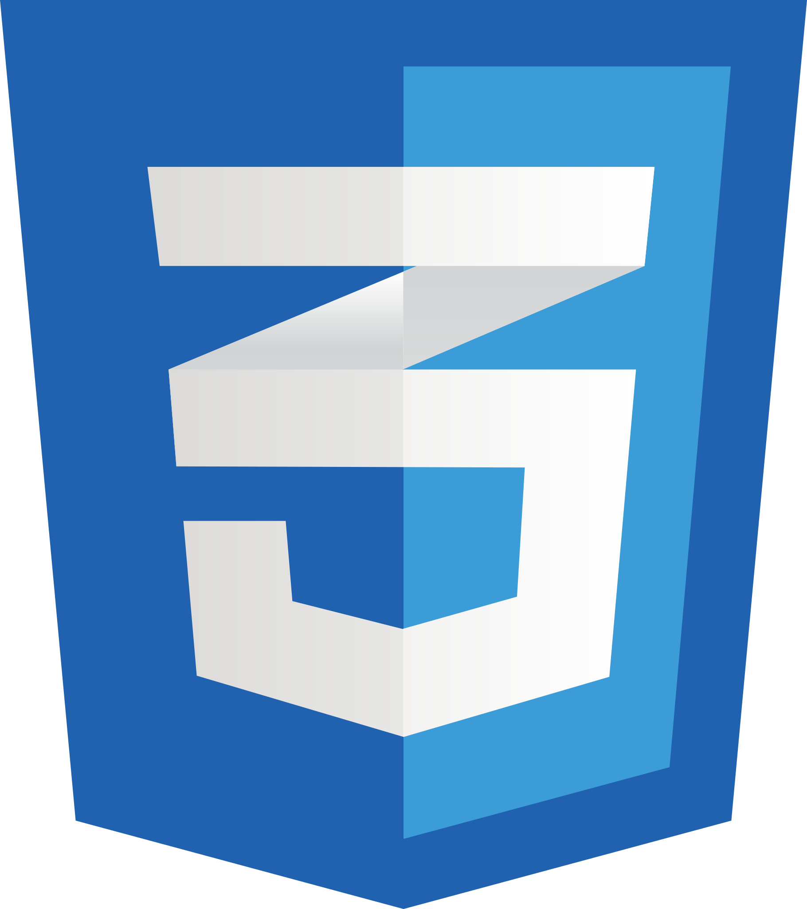

</br>
# 👋 Hi there, My name is Takuto!
I'm currently studying Web Development in Cornerstone Community College.
And, I'm looking for Web Development or Software engineer position now.
## 💾 PROFILE SUMMARY
- Digital design and web development professional with over 3 years of experience in project management, digital content creation, website maintenance, and visual communication across technology and community-focused projects.
- Availability: Full-time employment starting in November 2027.
```
name: Takuto Yokomaku
based_in: Vancouver, British Columbia
Position: Full Stack Developer
background: [
    "Graphic Designer",
    "Project Manager",
    "Engineer"
    ]
interests: [
  "Web and Mobile Development",
  "UI/UX Design",
  "Graphic Design"
  ]
currently_learning: [
  "JavaScript",
  "TypeScript"
  ]
primal_goals: [
    "Get a job at a Canadian or American Tech company",
    "Contribute start-up ecosystem in Canada"
  ]
hobbies: [
  "Gaming",
  "Reading Books",
  "Traveling",
  "Watching Movies"
  ]
```
## 🛠️TECH STACK
### Fronted Development




HTML, CSS, SCSS, JavaScript, TypeScript
### Web Development Tools
WordPress, Elementor, Next.js
### Development Environment
Git, GitHub, Visual Studio Code, Node.js, npm
### Design & Content
UI Design, Visual Communication, Adobe Creative Suite, Digital Content Creation
### Project Management
Website Maintenance, Version Control, Cross-functional Collaboration, Project Coordination


<!--
**yokomac/yokomac** is a ✨ _special_ ✨ repository because its `README.md` (this file) appears on your GitHub profile.

Here are some ideas to get you started:

- 🔭 I’m currently working on ...
- 🌱 I’m currently learning ...
- 👯 I’m looking to collaborate on ...
- 🤔 I’m looking for help with ...
- 💬 Ask me about ...
- 📫 How to reach me: ...
- 😄 Pronouns: ...
- ⚡ Fun fact: ...
-->
